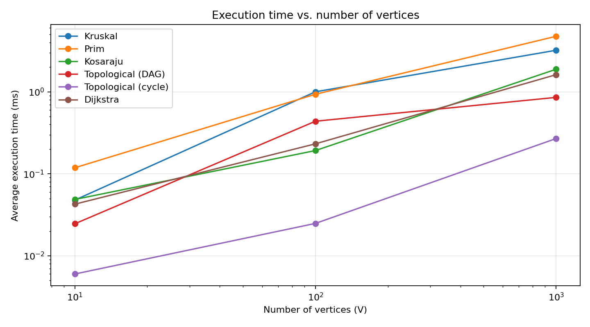
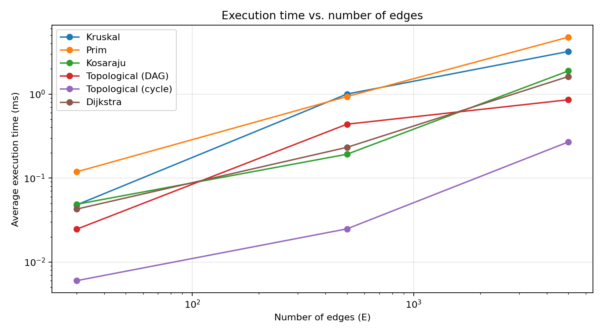

# Assignment 3 — Smart City Infrastructure and Route Planning
## Overview
This is a Java program about city roads. Districts are vertices, roads are edges, and weights are costs or distances. I used adjacency lists and both directed and undirected graphs.

## Implementation
- **DSU:** `find` uses path compression and `union` uses union by size.
- **Kruskal:** sorts edges and uses DSU to avoid cycles.
- **Prim:** uses a priority queue to choose cheap edges.
- **Kosaraju:** uses two DFS passes and a reversed graph to find SCCs.
- **Topological Sort (Kahn):** processes vertices with no incoming edges. It detects cycles when an ordering is impossible.
- **Dijkstra:** uses a priority queue to find shortest distances and paths. Unreachable vertices have distance `INF`.
Kruskal and Prim also return the total MST weight and whether the graph is connected. Dijkstra uses non-negative weights because negative weights can change a distance that was already chosen.

To run: mark `src` as **Sources Root** in IntelliJ and run `Main.java`. It runs the tests, examples and experiments. Only standard Java is used.

## Complexity Analysis
`V` = vertices, `E` = edges. I used adjacency lists and binary-heap priority queues.

| Algorithm | Time | Extra space |
| --- | --- | --- |
| DSU `find` / `union` | `O(α(V))` amortized | `O(V)` |
| Kruskal | `O(E log E + E α(V))` | `O(V + E)` |
| Prim | `O(E log V)` | `O(V + E)` |
| Kosaraju | `O(V + E)` | `O(V + E)` |
| Topological Sort | `O(V + E)` | `O(V)` |
| Dijkstra | `O((V + E) log V)` | `O(V + E)` |

`α(V)` grows very slowly. Path compression and union by size make DSU faster. Kruskal sorts edges; Prim and Dijkstra use queues. Kosaraju and Topological Sort check vertices and edges. More vertices and edges usually mean more work and memory.

## Experimental Setup
| Graph | V | E |
| --- | ---: | ---: |
| Small | 10 | 30 |
| Medium | 100 | 500 |
| Large | 1000 | 5000 |

I used fixed random seeds to make repeatable graphs. Undirected graphs are connected. In DAGs, edges go from lower to higher vertex numbers. Cyclic graphs contain `0 → 1 → 2 → 0`. Other edges are random and unique, with weights from 1 to 20. Seeds: `42 + V`, `142 + V`, `242 + V` for these graph types.
Each algorithm runs **5 times** for every size. `System.nanoTime()` measures the algorithm (not graph generation). I record average time and operation counts, such as edge checks, comparisons, DSU calls and queue operations.

## Results
Each value means **average time (ms) / average operations**. Results are also saved in `results/tables/benchmark.csv`.
| Algorithm | Small | Medium | Large |
| --- | ---: | ---: | ---: |
| Kruskal | 0.048 / 185 | 1.001 / 4858 | 3.211 / 58023 |
| Prim | 0.119 / 105 | 0.934 / 1713 | 4.752 / 17833 |
| Kosaraju | 0.049 / 90 | 0.192 / 1500 | 1.883 / 15000 |
| Topological (DAG) | 0.025 / 60 | 0.438 / 1000 | 0.855 / 10000 |
| Topological (cycle) | 0.006 / 30 | 0.025 / 500 | 0.269 / 5000 |
| Dijkstra | 0.043 / 54 | 0.232 / 740 | 1.618 / 7412 |

Time vs. vertices:

Time vs. edges:

## Comparison and Discussion
Kruskal and Prim give the same MST weight. Kruskal sorts edges; Prim uses a queue. Their operation counts measure different things, so they cannot be compared directly. DSU is efficient because of path compression and union by size.
Kosaraju and Dijkstra usually take longer on bigger graphs. Topological Sort works on DAGs and detects cycles. This agrees with the complexity analysis. Exact times vary between runs. Here `V` and `E` grow together, so the plots cannot show their effects separately.

## Testing
I ran **7 tests**: small graph, disconnected graph, DAG and cycle, multiple MSTs with equal weights, SCCs, unreachable vertex, and single vertex.
They check MST weights, valid topological order, cycle detection, that each vertex belongs to one SCC, and correct Dijkstra distances and paths.

**Result: 7/7 passed.**
## Conclusion
Kruskal and Prim help build a low-cost road network. Kosaraju finds strongly connected districts. Topological Sort orders tasks without cycles. Dijkstra finds shortest routes with non-negative weights.
